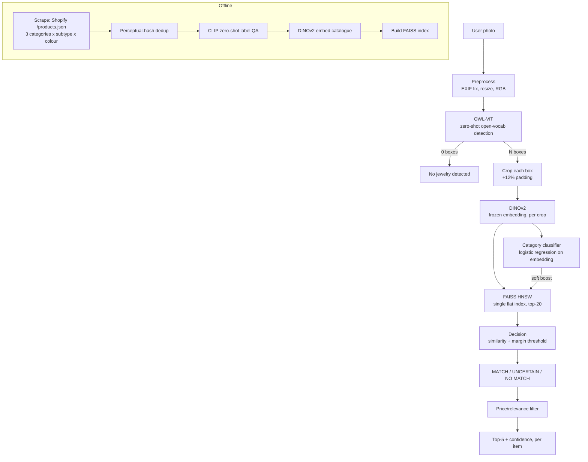

# DECISIONS.md — Jewel Lens (Stump the Model, Problem 2)

## Category choice

We chose jewellery — specifically earrings, necklaces, and bracelets — over watches, eyewear, or footwear. Earrings and necklaces in particular are common, everyday-worn items with huge design variety (colour, material, subtype), which gives a catalogue-matching system real versatility to demonstrate on. This category also mirrors how Dyla itself started out, making it a natural, closer-to-home choice to build against.

## Architecture

**Pipeline:** photo → OWL-ViT detection (zero-shot, prompted per category) → per-box crop → DINOv2 embedding (frozen) → category classifier (soft re-rank signal only) + FAISS similarity search (single flat HNSW index) → similarity+margin decision → price/relevance filter → top-5 with confidence, independently per detected item.

**Catalogue:** ~3,800 listings / ~13,300 images, scraped from public Shopify `/products.json` endpoints across multiple Indian and Western jewellery stores, spanning 3 categories (earring, necklace, bracelet — jhumka etc. tracked as subtype metadata, not a separate class) and a 16-colour palette.

## All decisions made

| Component | Chosen | Alternatives considered | Why |
|---|---|---|---|
| Detection model | OWL-ViT (zero-shot open-vocab) | YOLO (fine-tuned) | No bounding-box training data available; COCO has no jewellery classes. Zero-shot text-prompted detection needed no labelled boxes at all. |
| Detection post-processing | NMS added | None (initial build) | Duplicate/overlapping boxes on the same object were a confirmed real bug in Phase 3 testing, not a labelling issue. |
| Detection prompts | Moderately descriptive phrase per category, tuned across 3 rounds | Bare category word; heavily elaborate descriptive phrase | Bare words under-specified; elaborate wording sometimes regressed correct detections (hurt jhumka recall specifically). Settled on the middle version based on measured results, not assumption. |
| Embedding model | DINOv2 (frozen) | CLIP | DINOv2 favoured for fine-grained visual discrimination (near-identical design variants) over CLIP's semantic/text-aligned space. CLIP still used separately for catalogue label QA, where zero-shot semantic classification is the actual need. |
| Retrieval index | FAISS HNSW, single flat index | Category-partitioned HNSW; IVF-PQ; brute-force | Partitioning solves a latency problem we don't have at ~13k items, and risks permanently excluding the correct item if the detector's unreliable category label routes to the wrong sub-index (confirmed happening in testing). IVF-PQ's memory savings only matter past ~1M items. Brute-force was considered as an honest baseline — comparably fast at this scale, but no headroom if the catalogue grows. |
| Category classifier | Logistic regression (C=0.01, `class_weight="balanced"`) | SVM; Naive Bayes | Logistic regression gives calibrated probabilities natively, needed for the soft re-rank/confidence signal, without SVM's extra Platt-scaling step. Naive Bayes rejected for violating the feature-independence assumption on correlated embedding dimensions. |
| Classifier regularization | C swept via 3-fold CV, C=0.01 selected | Default C=1.0 | Default showed a train/val gap (100% vs 96.66%) indicating mild overfit. The sweep improved *both* held-out splits, not just closing the gap — confirmed generalization improvement, not just regularization for its own sake. |
| Classifier's role in retrieval | Soft re-rank boost on top-20 results | Hard category routing / pre-filtering | Routing risks permanently losing the correct item when the classifier or detector mislabels category — confirmed happening in real testing. A soft boost keeps retrieval similarity as the dominant, better-generalizing signal. |
| Confidence / no-match decision | Similarity + margin thresholds, set from a small manual sample | Full ROC/FAR-FRR calibration | Descoped in favour of doing the multi-item extension properly rather than two shallow extensions, per the brief's own guidance. |
| Catalogue source | Public Shopify `/products.json` scraping | Etsy API; eBay API; stock-photo APIs (Pexels/Pixabay); purchased dataset (DataSeeds.ai) | Etsy access was rejected/banned; eBay approval didn't arrive in time. Stock-photo APIs have no real per-item structure or price and thin jewellery-specific volume. A purchased dataset would conflict with the brief's "assemble the catalogue yourself by scraping" requirement. |
| Category taxonomy | 3 top-level classes (earring/necklace/bracelet); jhumka etc. tracked as subtype metadata | Jhumka as a 4th top-level class | Jhumka is genuinely a subtype of earring, not a sibling category. Keeping it as metadata avoids taxonomy ambiguity in classifier training and in the confused-pairs analysis. |
| Colour palette | 16 colours (metallic + stone/finish), applied uniformly across categories | Gold/silver only; custom per-category lists | An initial 2-colour palette was too thin to satisfy "different colours" coverage. A uniform full palette gave consistent facet coverage without extra scraping logic per category. |
| Catalogue cleaning | Two-stage: perceptual hashing (pHash) then CLIP zero-shot label QA | Single-stage exact-hash dedup only; no dedup | pHash catches near-identical/resized stock photos reused across different sellers — exact-hash matching misses resized/recompressed duplicates. CLIP QA separately catches category-mismatched images that scraping's keyword filter still let through — a different failure mode from duplication, needing a different check. |
| Multi-item handling | Natural consequence of running the pipeline once per detected box | A separate multi-item detection/matching model | The architecture already produces independent crops per box; no additional model was needed. Verified directly via spatial-distinctness and duplicate-result checks (7/7 multi-item test photos passed cleanly). |
| Price/relevance filter | Post-retrieval metadata filter/sort | A ranking model incorporating price as a learned signal | Kept as pure post-processing on already-computed results — no retraining, no new signal, deliberately capped effort as polish rather than core work. |
| Shop name, price, and listing URL shown per result | Displayed alongside every returned candidate | Returning only an internal catalogue ID/score | A bare similarity score doesn't tell a user anything actionable. Since every catalogue item traces back to a real store listing, surfacing which shop it's from and its price gives people an immediate, concrete sense of the match (a real product they could actually go look at or buy), rather than an abstract "confidence: 0.82" — it's what turns a retrieval result into something a person can actually use. |
| Frontend stack | Flask + vanilla HTML/JS | Streamlit; React | Streamlit is fastest to build but has no resume value, which mattered for this submission. Flask + vanilla JS balances resume relevance against build-time cost without a frontend framework's setup overhead. |
| Scrape reliability | Per-domain progress tracking with retry/backoff, resumable across runs | One-shot script, no resume | Etsy's rate limits (5 QPS / 5000 QPD) and Shopify storefronts' own limits made crash-safe resumability necessary, not optional, after an early run was interrupted mid-scrape. |
| Learned matching model | Frozen pretrained DINOv2, no fine-tuning by default | CNN trained from scratch; Siamese/triplet network; cross-encoder reranker | All three need paired training data (same physical item, multiple real photos) we didn't reliably have going in. Cross-encoder also multiplies inference cost per query (one forward pass per candidate). Not worth the build risk in 3 days — flagged as a "with more time" item instead. |
| LLM/VLM usage | Offline only — catalogue label QA and stumper-photo labelling assist | An LLM/VLM call inside the live matching pipeline | An online VLM call adds hundreds of ms to seconds per query, directly undermining the latency requirement, and isn't more accurate here than our calibrated embedding-similarity signal, which we can inspect and explain — a VLM's yes/no can't be interrogated the same way. |

## Trade-offs under the time limit

- **Category classifier has a documented bias**: trained with `class_weight="balanced"`, C-tuned via CV (97% test accuracy), but its intercepts are skewed toward the majority class (earring), and it defaults to "earring" on several real (non-catalogue-domain) test photos even when clearly wrong. We mitigated this by keeping its re-rank influence deliberately small (`RERANK_BOOST_WEIGHT=0.08`) so retrieval similarity — the stronger, better-generalizing signal — dominates final ranking. Confirmed on catalogue-style test images that even in-distribution photos triggered the same bias, ruling out "just a domain-gap problem."
- **Thresholds (similarity/margin) are hand-set from a small manual sample** (18 positives, 6 negatives), not a full ROC sweep — acceptable given the descoped-open-set decision, but not statistically robust.
- **Subtype and colour metadata are ~60% blank** — title-keyword extraction from scraped Shopify data is imperfect; planned VLM backfill wasn't completed.
- **A handful of self-owned physical items were added to the catalogue** (studio-style reference photo) specifically so Part B could shoot verified hard-condition photos of items with known ground truth, since most scraped catalogue items aren't physically accessible to us.

## Known failure modes (diagnosed, not guessed)

- **Round/circular-shaped earrings (jhumka, hoops) are frequently mislabelled `bracelet` by OWL-ViT**, worse when held in a hand — confirmed across three independent prompt variants; this is a genuine zero-shot detector limitation, not a bug.
- **Retrieval (DINOv2+FAISS) is more robust than either the detector's or classifier's category label** — in every case checked, the actual returned images were visually/stylistically correct even when the upstream label was wrong.
- **Multi-item detection is structurally sound**: 7/7 multi-item test photos passed spatial-distinctness and independent-retrieval checks, with zero duplicate-crop or duplicate-result bugs. A 4-item photo does compound detector-labelling risk (4 chances to mislabel vs. 1), which is a separate, real limitation from the multi-item mechanism itself.
- **Detection is the dominant latency cost**, not FAISS retrieval (confirmed via per-stage profiling) — retrieval is near-instant regardless of catalogue growth at this scale.

## Testing

**Quantitative results** (stumper set: 183 non-negative photos across earring/necklace/bracelet/mixed folders, 12 negatives; ground truth from folder structure, independent of the retrieval/classifier models being tested):

| Metric | Result |
|---|---|
| Detection Recall | 1.000 (183/183 jewelry photos got ≥1 box) |
| Category Accuracy | 0.665 |
| No-match precision (negatives correctly rejected) | 0.583 |
| Confused pairs | necklace → earring: 28, bracelet → earring: 27 |

Exact-match retrieval metrics (Recall@1/5, MRR) were descoped: the stumper photos are the author's own personal jewelry, never listed on any scraped store, so there is no catalogue-ID ground truth to match against — the "correct" item may legitimately not exist in the catalogue at all. Retrieval quality was instead evaluated qualitatively (below), via a full visual review of every stumper photo's top-5 results (`review_report.html`).

**Positives found in review:**
- Detection boxes are accurate on the large majority of clean, single-item photos.
- Blurred photos were still handled well — DINOv2 embeddings are reasonably blur-robust.
- Multi-item photos mostly detect and retrieve each item independently and correctly.
- Even when the upstream category label was wrong, the retrieved images were still visually/stylistically close to the query (consistent with the "retrieval is more robust than the label" finding above).

**Failures found in review, beyond what training-time testing had already caught:**
- **Chain necklaces (4 photos) get cropped "2 and 2"** — the detector proposes two boxes near the chain's two ends, and since they barely overlap, NMS (which only suppresses high-IoU pairs) treats them as two separate objects instead of merging them into one continuous chain.
- **Overlapping earrings (worn as a pair) sometimes collapse into a single detection** — the mirror-image failure of the chain issue: two genuinely distinct, overlapping items produce high-IoU boxes, so NMS discards one as a "duplicate." Same root cause (NMS is a purely geometric heuristic, blind to object identity) producing opposite symptoms.
- **Necklace pendants get detected/classified as earrings** — a solitary pendant, cropped in isolation, has the same small/dangling silhouette OWL-ViT associates with "earring." Same shape-based root cause already documented for jhumka/hoop → bracelet, just in the other direction.
- **Bracelets held in the hand get cropped too small and misclassified as earring** — hand occlusion reduces the detection box to a small curved segment (a clasp or charm) rather than the full bracelet, and that reduced crop reads as earring-shaped.
- **Mixed-folder photos where 1 item is detected but the result retrieved is a multi-piece "set" listing** — several catalogue listings are themselves sets (e.g. "necklace and earring set") but carry a single category label from keyword matching; a single-item crop can legitimately have a set-listing as its nearest visual neighbour. This is a catalogue-labelling limitation, not a detection or retrieval bug.

## With two more weeks

1. Fix the classifier's intercept bias properly (class-balanced resampling instead of relying on `class_weight`) and re-validate against real photos, not just held-out catalogue data.
2. Run a proper ROC-calibrated open-set threshold sweep using a much larger negative set.
3. Backfill subtype/colour metadata via VLM-assisted QA on the ~60% currently blank.
4. Investigate a lightweight contrastive fine-tune of DINOv2's last layers using the real same-item photo pairs captured from multi-image Shopify listings — a more honest training signal than synthetic augmentation alone.
5. Automate the stumper set (programmatic hard-case generation) and compare its defeat rate against the hand-shot set.
6. Scale-test the catalogue toward 100k items and re-profile latency under that load with `efSearch` tuning.
7. **Expand filtering beyond price** — the current filter mirrors what every shopping app offers (sort/filter on results), but we scoped it to price only since it's the single most-used filter for a first version. With more time this extends naturally to material, colour, and subtype filters using metadata we already scrape but haven't fully backfilled (point 3 above unblocks this).
8. A "find similar to this result" loop — clicking a returned catalogue item re-queries the index using that item's own embedding, letting a user browse outward from a match instead of only searching from their own photo.
9. Lightweight feedback capture (thumbs up/down per result) to build a real labelled dataset over time for retraining the classifier and calibrating thresholds, rather than relying on our small hand-built test sets.
10. Revisit the dress→jewellery cross-domain recommendation idea we deliberately cut early — a genuinely different, higher-effort feature, better suited to a longer build.
11. Merge same-class adjacent boxes for elongated objects (chains) and reconsider NMS's overlap-only merge logic so it stops conflating "two segments of one object" with "two distinct overlapping objects" — the two review-set failures documented above are opposite symptoms of that same fix.