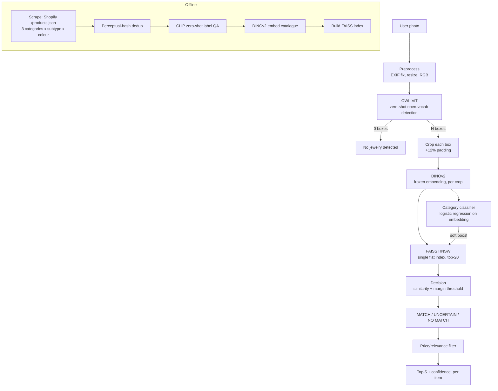

# DECISIONS.md — Jewel Lens (Stump the Model, Problem 2)

## Architecture

**Pipeline:** photo → OWL-ViT detection (zero-shot, prompted per category) → per-box crop → DINOv2 embedding (frozen) → category classifier (soft re-rank signal only) + FAISS similarity search (single flat HNSW index) → similarity+margin decision → price/relevance filter → top-5 with confidence, independently per detected item.

**Catalogue:** ~3,800 listings / ~13,300 images, scraped from public Shopify `/products.json` endpoints across multiple Indian and Western jewellery stores, spanning 3 categories (earring, necklace, bracelet — jhumka etc. tracked as subtype metadata, not a separate class) and a 16-colour palette.

## What we rejected, and why

- **YOLO for detection** — needs bounding-box training data we don't have; COCO has no jewellery classes. OWL-ViT's zero-shot text-prompted detection needed no labelled boxes at all.
- **Category-partitioned FAISS indices** — designed for 100k-scale latency, unnecessary at ~13k images (a flat index is already single-digit ms). We also found empirically that a wrong detector category label would have permanently excluded the correct catalogue item under partitioning; a flat index let retrieval recover regardless of the detector's label.
- **CNN trained from scratch, Siamese/triplet fine-tuning, cross-encoder reranker** — all need paired training data (same physical item, multiple photos) we didn't reliably have at the start; not worth the build risk in 3 days.
- **Full ROC-calibrated open-set rejection (FAR/FRR)** — descoped in favour of one deep extension (multi-item) rather than two shallow ones, per the brief's own guidance.
- **Etsy API** — application was rejected/banned; eBay approval didn't arrive in time. Fell back to scraping public Shopify endpoints (no auth required), which also let us capture every listing image (not just the primary), giving real same-item photo pairs "for free."

## Trade-offs under the time limit

- **Category classifier has a documented bias**: trained with `class_weight="balanced"`, C-tuned via CV (97% test accuracy), but its intercepts are skewed toward the majority class (earring), and it defaults to "earring" on several real (non-catalogue-domain) test photos even when clearly wrong. We mitigated this by keeping its re-rank influence deliberately small (`RERANK_BOOST_WEIGHT=0.08`) so retrieval similarity — the stronger, better-generalizing signal — dominates final ranking. Confirmed on catalogue-style test images that even in-distribution photos triggered the same bias, ruling out "just a domain-gap problem."
- **Thresholds (similarity/margin) are hand-set from a small manual sample** (18 positives, 6 negatives), not a full ROC sweep — acceptable given the descoped-open-set decision, but not statistically robust.
- **Subtype and colour metadata are ~60% blank** — title-keyword extraction from scraped Shopify data is imperfect; planned VLM backfill wasn't completed.
- **A handful of self-owned physical items were added to the catalogue** (studio-style reference photo) specifically so Part B could shoot verified hard-condition photos of items with known ground truth, since most scraped catalogue items aren't physically accessible to us.

## Known failure modes (diagnosed, not guessed)

- **Round/circular-shaped earrings (jhumka, hoops) are frequently mislabelled `bracelet` by OWL-ViT**, worse when held in a hand — confirmed across three independent prompt variants; this is a genuine zero-shot detector limitation, not a bug.
- **Retrieval (DINOv2+FAISS) is more robust than either the detector's or classifier's category label** — in every case checked, the actual returned images were visually/stylistically correct even when the upstream label was wrong.
- **Multi-item detection is structurally sound**: 7/7 multi-item test photos passed spatial-distinctness and independent-retrieval checks, with zero duplicate-crop or duplicate-result bugs. A 4-item photo does compound detector-labelling risk (4 chances to mislabel vs. 1), which is a separate, real limitation from the multi-item mechanism itself.
- **Detection is the dominant latency cost**, not FAISS retrieval (confirmed via per-stage profiling) — retrieval is near-instant regardless of catalogue growth at this scale.

## Testing

*[To be completed after the Part B stumper set (100 hard photos + 20 negatives) and eval harness are run — Recall@1/5, MRR, Detection Recall, Category Accuracy, confused-pairs, and per-failure-condition breakdown.]*

## With two more weeks

1. Fix the classifier's intercept bias properly (class-balanced resampling instead of relying on `class_weight`) and re-validate against real photos, not just held-out catalogue data.
2. Run a proper ROC-calibrated open-set threshold sweep using a much larger negative set.
3. Backfill subtype/colour metadata via VLM-assisted QA on the ~60% currently blank.
4. Investigate a lightweight contrastive fine-tune of DINOv2's last layers using the real same-item photo pairs captured from multi-image Shopify listings — a more honest training signal than synthetic augmentation alone.
5. Automate the stumper set (programmatic hard-case generation) and compare its defeat rate against the hand-shot set.
6. Scale-test the catalogue toward 100k items and re-profile latency under that load with `efSearch` tuning.